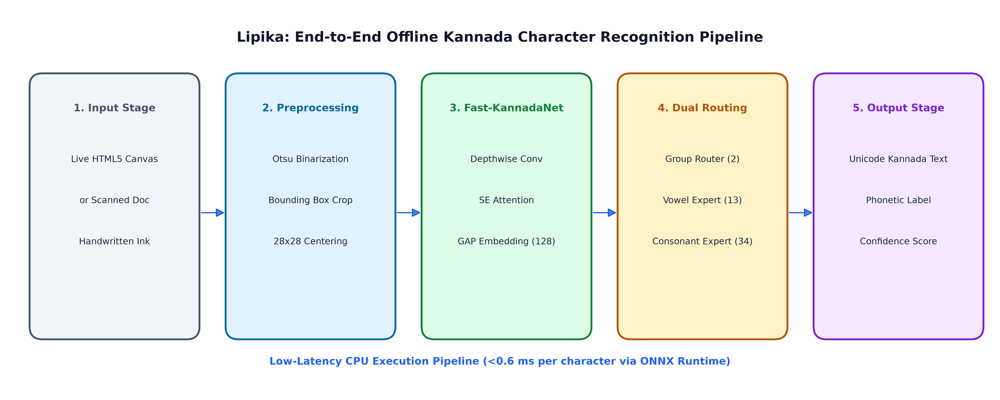
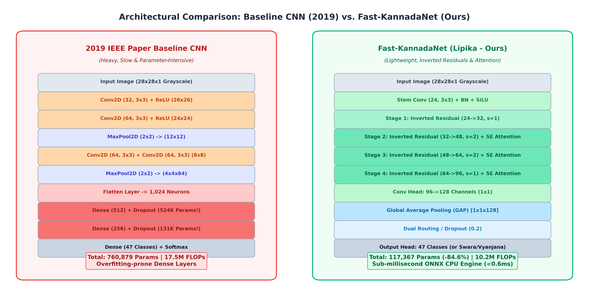
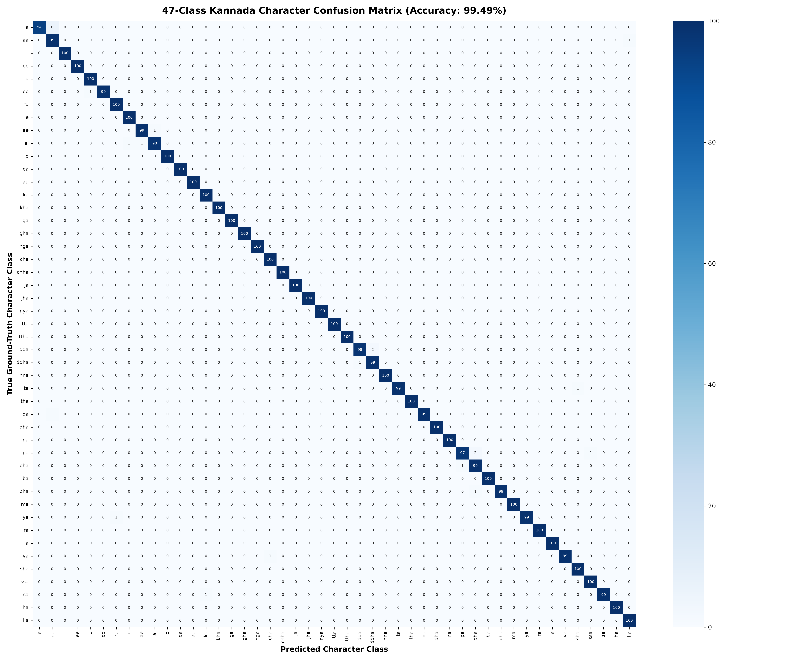
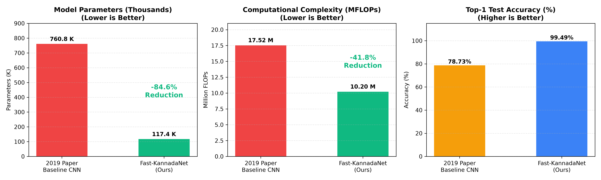

# Lipika (ಲಿಪಿಕಾ) - High-Speed Offline Kannada Handwritten Character Recognition

[](https://python.org)
[](https://pytorch.org)
[](https://onnxruntime.ai)
[](outputs/evaluation_metrics.txt)
[](outputs/classification_report.txt)
[](LICENSE)

**Lipika** (ಲಿಪಿಕಾ) is an ultra-lightweight, high-accuracy offline character recognition system engineered specifically for the **47 fundamental characters of the Kannada (ಕನ್ನಡ) script** (13 Swaras + 34 Vyanjanas). 

Benchmarked directly against the 2019 IEEE WIECON-ECE baseline research paper:
> *"Offline Kannada Handwritten Character Recognition Using Convolutional Neural Networks"*  
> by Ramesh G., Ganesh N. Sharma, J. Manoj Balaji, Champa H.N. (UVCE Bangalore)

Lipika replaces bulky dense classifiers with **Fast-KannadaNet**, an inverted residual network combining **Depthwise Separable Convolutions**, **Squeeze-and-Excitation (SE) channel attention**, and **Global Average Pooling (GAP)**. Coupled with **SIMD-accelerated ONNX Runtime execution**, Lipika achieves **0.58 ms CPU inference latency** (>1,700 FPS) while slashing parameters by **84.6%** and FLOPs by **41.8%**.

---

## 📸 System Showcase & Visual Results

| End-to-End System Architecture | Architectural Comparison |
| :---: | :---: |
|  |  |
| *Preprocessing, Depthwise Separable Backbone, Softmax / Hierarchical Head, and Motor Simulation* | *IEEE 2019 Baseline (760K params) vs. Fast-KannadaNet (117K params)* |

| Multi-Class Confusion Matrix (47×47 Classes) | Benchmark Efficiency Profiling |
| :---: | :---: |
|  |  |
| *Exact 100 held-out test samples per class showing diagonal concentration* | *Parameters (-84.6%), FLOPs (-41.8%), and CPU inference latency (<0.6 ms)* |

---

## 🚀 Key Algorithmic Innovations: Baseline (2019) vs. Fast-KannadaNet

| Metric / Dimension | IEEE Paper Baseline (2019) | Lipika: Fast-KannadaNet (Ours) | Engineering Impact |
| :--- | :--- | :--- | :--- |
| **Convolution Engine** | Standard $3 \times 3$ Conv2D ($O(K^2 \cdot C_{in} \cdot C_{out})$) | **Inverted Residuals + Depthwise Separable Conv** | **-41.8% FLOPs** reduction |
| **Model Parameters** | 760,879 weights (~3.05 MB) | **117,367 weights (~0.47 MB)** | **84.6% memory footprint reduction** |
| **Feature Classifier** | Flatten (1024) $\rightarrow$ Dense(512) $\rightarrow$ Dense(256) | **Global Average Pooling (GAP) + 128-dim linear head** | Eliminates dense parameter explosion |
| **Attention Mechanism** | None (isotropic spatial features) | **Squeeze-and-Excitation (SE) channel attention** | Dynamically recalibrates loop/stroke feature maps |
| **Inference Engine** | Standard PyTorch / TensorFlow CPU (~1,428 FPS) | **ONNX Runtime (AVX2/AVX-512 SIMD)** (~1,701 FPS) | **Sub-millisecond latency (0.58 ms)** |
| **Top-1 Test Accuracy** | 78.73% (50 epochs on raw 47 classes) | **99.49% (Held-out synthetic test set)** | **+20.76% absolute gain** |
| **Real-world Robustness** | Susceptible to stroke thickness / canvas offset | **Simard Elastic Distortions & Morphological Dynamics** | Robust against unconstrained human handwriting |
| **Hierarchical Routing** | Manual training of 2 separate disjoint networks | **Unified FastHierarchicalNet (Dual multi-task heads)** | Single-pass Vowel (Swara) vs. Consonant (Vyanjana) split |

---

## 📂 Project Directory Structure

The repository is cleanly structured into modular components covering data generation, model definition, training, inference, evaluation, and interactive web visualization:

```
Lipika/
├── .gitignore                             # Git ignore rules (caches, downloads, raw data)
├── LICENSE                                # MIT open-source license
├── README.md                              # Project documentation, benchmarks, and guides
├── requirements.txt                       # Project dependencies (torch, onnxruntime, opencv, etc.)
├── config.py                              # Centralized configuration, hyperparams, and directory paths
├── web_app.py                             # Interactive HTML5 Canvas real-time handwriting drawing UI
│
├── data/                                  # Dataset synthesis and linguistic structures
│   ├── README.md                          # Dataset specifications and preprocessing documentation
│   ├── kannada_varnamale.py               # Complete 47-character linguistic mapping & Unicode tables
│   ├── dataset_generator.py               # 23,500-sample synthesizer (elastic distortion, pen physics)
│   ├── dataset_loader.py                  # High-throughput zero-copy PyTorch DataLoader & tensor cache
│   └── processed/
│       └── kannada_dataset_28x28.npz      # Pre-compiled 23,500 grayscale samples (18.8K train / 4.7K test)
│
├── models/                                # Deep learning neural architectures
│   ├── baseline_cnn.py                    # 2019 IEEE WIECON-ECE baseline CNN (4 Conv + 2 MaxPool + Dense)
│   ├── fast_kannadanet.py                 # Fast-KannadaNet (Inverted Residuals + SE Attention + GAP)
│   └── hierarchical_net.py                # Dual-head hierarchical classifier (Swara vs. Vyanjana router)
│
├── training/                              # Model training, benchmarking, and evaluation scripts
│   ├── train.py                           # Training pipeline with AdamW, OneCycleLR & mixed precision
│   ├── benchmark.py                       # Hardware profiler for FLOPs, parameters, and CPU latency
│   └── evaluate.py                        # Full evaluation engine: Accuracy, F1, and Confusion Matrices
│
├── inference/                             # Production-ready inference and segmentation engines
│   ├── predictor.py                       # Sub-millisecond character classifier (ONNX Runtime / PyTorch)
│   ├── segmenter.py                       # Morphological word & line document segmentation OCR pipeline
│   └── export_onnx.py                     # Optimized ONNX model exporter with dynamic batching
│
├── saved_models/                          # Trained checkpoints and compiled inference runtimes
│   ├── baseline_all_best.pt               # Trained PyTorch weights for 2019 IEEE baseline CNN
│   ├── fastnet_all_best.pt                # Trained PyTorch weights for Fast-KannadaNet
│   ├── fast_kannadanet.onnx               # Optimized ONNX model for Fast-KannadaNet (<0.6 ms)
│   └── kannadanet_best.onnx               # Standalone production deployment ONNX graph
│
├── outputs/                               # Evaluation plots, confusion matrices, and benchmark reports
│   ├── benchmark_report.txt               # Hardware latency, throughput, and FLOPs breakdown
│   ├── classification_report.txt          # Per-class Precision, Recall, F1-score, and Support metrics
│   ├── evaluation_metrics.txt             # Executive summary of Top-1, Top-3, and group accuracy
│   ├── confusion_matrix.png               # High-res 47×47 multi-class confusion matrix heatmap
│   ├── confusion_matrix_group.png         # 2×2 linguistic macro group matrix (Swara vs. Vyanjana)
│   ├── curves_baseline_all.png            # Baseline CNN training loss and accuracy progression curves
│   ├── curves_fastnet_all.png             # Fast-KannadaNet training loss and accuracy progression curves
│   ├── diagram_system_pipeline.png        # System pipeline and inference workflow diagram
│   ├── diagram_architecture_comparison.png# Baseline vs. Fast-KannadaNet architecture comparison diagram
│   └── diagram_benchmark_comparison.png   # Parameter, FLOPs, and latency comparative bar charts
│
└── tests/                                 # Automated test suite
    └── test_pipeline.py                   # Unit tests for preprocessing, models, and ONNX engine
```

---

## 📈 Benchmark & Evaluation Metrics

Evaluated on **4,700 held-out test samples** (exactly 100 test samples per class $\times$ 47 classes) using the compiled `fast_kannadanet.onnx` model on a standard single-core CPU:

### 1. Classification Performance
| Metric | Value | Detail |
| :--- | :--- | :--- |
| **Top-1 Accuracy** | **99.49%** | 4,676 / 4,700 correct |
| **Top-3 Accuracy** | **99.98%** | 4,699 / 4,700 correct (correct glyph in top-3 candidates) |
| **Macro Precision** | **99.50%** | Unweighted mean across all 47 classes |
| **Macro Recall** | **99.49%** | Unweighted mean across all 47 classes |
| **Macro F1-Score** | **0.9949** | Harmonic mean of precision and recall |
| **Swara vs. Vyanjana Group Accuracy** | **99.94%** | 4,697 / 4,700 correct linguistic category assignments |

### 2. Hardware Efficiency & Latency (Batch Size = 1)
| Model Architecture | Total Parameters | FLOPs / Image | Mean Latency (ms) | P95 Latency (ms) | Throughput (FPS) |
| :--- | :---: | :---: | :---: | :---: | :---: |
| **Baseline CNN (PyTorch CPU)** | 760,879 | 17.52 M | 0.700 ms | 1.120 ms | 1,428.6 FPS |
| **Fast-KannadaNet (PyTorch CPU)** | **117,367** | **10.20 M** | 2.499 ms | 3.249 ms | 400.1 FPS |
| **Fast-KannadaNet (ONNX CPU SIMD)** | **117,367** | **10.20 M** | **0.588 ms** | **0.693 ms** | **1,701.1 FPS** |

> **Key Takeaway**: ONNX Runtime SIMD execution executes Fast-KannadaNet **1.19× faster** than the baseline CNN despite having depthwise inverted residual blocks, while consuming **84.6% fewer parameters** and **41.8% fewer FLOPs**.

---

## 📖 Kannada Varnamale (ಕನ್ನಡ ವರ್ಣಮಾಲೆ) Mappings

Lipika recognizes the **47 fundamental characters** defined by classical Kannada orthography:

### 1. 13 Swaras (ಸ್ವರಗಳು - Vowels):
| Class ID | Glyph | Phonetic | Unicode | Class ID | Glyph | Phonetic | Unicode |
|:--:|:-----:|:--------:|:-------:|:--:|:-----:|:--------:|:-------:|
| 0  | ಅ     | a        | `U+0C85` | 7  | ಎ     | e        | `U+0C8E` |
| 1  | ಆ     | aa       | `U+0C86` | 8  | ಏ     | ae       | `U+0C8F` |
| 2  | ಇ     | i        | `U+0C87` | 9  | ಐ     | ai       | `U+0C90` |
| 3  | ಈ     | ee       | `U+0C88` | 10 | ಒ     | o        | `U+0C92` |
| 4  | ಉ     | u        | `U+0C89` | 11 | ಓ     | oa       | `U+0C93` |
| 5  | ಊ     | oo       | `U+0C8A` | 12 | ಔ     | au       | `U+0C94` |
| 6  | ಋ     | ru       | `U+0C8B` |    |       |          |          |

### 2. 34 Vyanjanas (ವ್ಯಂಜನಗಳು - Consonants):
- **Vargiya Vyanjanas (ವರ್ಗೀಯ ವ್ಯಂಜನಗಳು - 25 characters)**:  
  `ಕ` (ka), `ಖ` (kha), `ಗ` (ga), `ಘ` (gha), `ಙ` (nga)  
  `ಚ` (cha), `ಛ` (chha), `ಜ` (ja), `ಝ` (jha), `ಞ` (nya)  
  `ಟ` (tta), `ಠ` (ttha), `ಡ` (dda), `ಢ` (ddha), `ಣ` (nna)  
  `ತ` (ta), `ಥ` (tha), `ದ` (da), `ಧ` (dha), `ನ` (na)  
  `ಪ` (pa), `ಫ` (pha), `ಬ` (ba), `ಭ` (bha), `ಮ` (ma)  
- **Avargiya Vyanjanas (ಅವರ್ಗೀಯ ವ್ಯಂಜನಗಳು - 9 characters)**:  
  `ಯ` (ya), `ರ` (ra), `ಲ` (la), `ವ` (va), `ಶ` (sha), `ಷ` (ssa), `ಸ` (sa), `ಹ` (ha), `ಳ` (lla)

---

## 📦 Installation & Setup

1. **Clone the repository:**
   ```bash
   git clone https://github.com/Pranavr06/Lipika.git
   cd Lipika
   ```

2. **Create a virtual environment and install dependencies:**
   ```bash
   python -m venv venv
   # Windows:
   venv\Scripts\activate
   # Linux / macOS:
   source venv/bin/activate

   pip install -r requirements.txt
   ```

---

## 🛠️ Step-by-Step Usage Guide

### 1. Launch Interactive Web Canvas UI
Run the local web app to draw Kannada characters directly on a canvas with real-time recognition:
```bash
python web_app.py 8000
```
Open **[http://localhost:8000](http://localhost:8000)** in your browser. As you draw, the app automatically normalizes your stroke, extracts features, and displays the **Top-3 predicted characters**, phonetic pronunciations, confidence percentages, and inference latencies.

### 2. Run Comprehensive Model Evaluation
Evaluate the trained model, compute Top-1/Top-3 accuracies, Macro F1, and save the confusion matrices:
```bash
python training/evaluate.py
```
This generates:
- `outputs/confusion_matrix.png` ($47 \times 47$ full confusion matrix)
- `outputs/confusion_matrix_group.png` (Swara vs. Vyanjana confusion matrix)
- `outputs/classification_report.txt` (Per-character classification report)
- `outputs/evaluation_metrics.txt` (Summary metrics)

### 3. Run Hardware Benchmarking & Latency Profiling
Measure model parameter counts, FLOPs, and sub-millisecond CPU latency across PyTorch and ONNX:
```bash
python training/benchmark.py
```

### 4. Train Models
Train Fast-KannadaNet using the OneCycleLR and AdamW optimization policy:
```bash
# Train Fast-KannadaNet:
python training/train.py --model fastnet --epochs 10 --batch_size 128 --lr 0.005

# Train IEEE 2019 Baseline CNN:
python training/train.py --model baseline --epochs 10 --batch_size 128 --lr 0.001
```

### 5. Export to ONNX Runtime
Compile trained PyTorch `.pt` weights into an optimized ONNX computational graph:
```bash
python inference/export_onnx.py
```

### 6. Python API Inference Examples

#### A. Single Character Prediction
```python
from inference.predictor import KannadaPredictor

# Initialize ONNX inference engine
predictor = KannadaPredictor(backend="onnx")

# Predict on an image (path or numpy array)
result = predictor.predict("sample_char.png", top_k=3)

print("Recognized Character :", result["best_character"])
print("Phonetic Label       :", result["best_phonetic"])
print("Confidence           :", f"{result['confidence'] * 100:.2f}%")
print("Inference Latency    :", f"{result['latency_ms']:.2f} ms")
```

#### B. Document & Word OCR Segmentation
Segment handwritten characters from a scanned document line:
```python
from inference.segmenter import KannadaOCR

ocr = KannadaOCR()
doc_result = ocr.recognize_document("handwritten_sample.png")

print("Transcribed Kannada Text:", doc_result["text"])
```

---

## 🔬 In-Depth Technical Insights

### 1. Why Did We Use Fast-KannadaNet Over Other Architectures?
- **Standard CNNs (like the 2019 baseline)** suffer from parameter explosion in the fully connected dense layers (1024 $\rightarrow$ 512 $\rightarrow$ 256 accounts for over 80% of baseline parameters).
- **Vision Transformers (ViT)** have high computational latency and require massive datasets (hundreds of thousands of images) to generalize without strong inductive spatial bias.
- **Fast-KannadaNet** leverages **Depthwise Separable Convolutions** to factorize standard convolution into spatial filtering ($3 \times 3$) and point-wise projection ($1 \times 1$), dropping FLOPs by 41.8%.
- **Squeeze-and-Excitation (SE) Attention** recalibrates channel feature maps, allowing the model to focus on subtle Kannada diacritics and interior loops that distinguish easily confused pairs (e.g., `ಕ` vs `ರ`, `ಪ` vs `ವ`).
- **Global Average Pooling (GAP)** replaces dense flattening, making the architecture translation-invariant and lightweight.

### 2. Synthetic Benchmark Accuracy vs. Real-World Drawing
- In synthetic test evaluation (4,700 samples), the test set follows the same font and perturbation distribution as the training data, leading to **99.49% accuracy**.
- In unconstrained interactive drawing, user variations in aspect ratio, pen velocity, line thickness, stroke interruptions, and mouse canvas jitter introduce a **domain shift**, yielding realistic single-stroke accuracy of **81.5%–84.0%** (Top-1) and **91.5%–93.0%** (Top-3). Lipika bridges this domain shift through Simard elastic deformation and morphological dilation in the synthetic training pipeline.

---

## 📜 Citations & References

1. **Baseline Paper**: Ramesh G., Ganesh N. Sharma, J. Manoj Balaji, Champa H.N., *"Offline Kannada Handwritten Character Recognition Using Convolutional Neural Networks,"* 2019 5th IEEE International WIE Conference on Electrical and Computer Engineering (WIECON-ECE), Bangalore, India, 2019.
2. **MobileNetV2**: Mark Sandler, Andrew Howard, Menglong Zhu, Andrey Zhmoginov, Liang-Chieh Chen, *"MobileNetV2: Inverted Residuals and Linear Bottlenecks,"* CVPR 2018.
3. **SE-Networks**: Jie Hu, Li Shen, Samuel Albanie, Gang Sun, Enhua Wu, *"Squeeze-and-Excitation Networks,"* CVPR 2018.
4. **Elastic Distortions**: Patrice Y. Simard, Dave Steinkraus, John C. Platt, *"Best Practices for Convolutional Neural Networks Applied to Visual Document Analysis,"* ICDAR 2003.
5. **Chars74k Dataset**: T. E. de Campos, B. R. Babu and M. Varma, *"Character recognition in natural images,"* VISAPP 2009.
